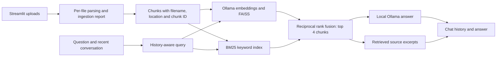

# ChatDoc — local document chat

powershell -NoProfile -ExecutionPolicy Bypass -File .\run.ps1

Upload PDF, TXT, CSV, DOCX, Markdown or text-based code files and ask questions about their content in a Streamlit interface. ChatDoc preserves source metadata, splits each document into chunks, and combines FAISS semantic search with BM25 keyword search. Answers include expandable source filenames, PDF pages and retrieved excerpts. Follow-up questions use session history, and prompt refinement is optional.

No OpenAI, AvalAI or Hugging Face API key is required. The first model downloads need internet access; document processing and chat then run locally. FAISS and chat history are kept in memory for the current session.

## Docker: one-command startup

Install Docker with the Compose plugin (Docker Desktop on Windows/macOS), start its Linux container engine, then run from the repository root:

```bash
docker compose up --build -d
```

Open http://localhost:8502. No host Python, uv or Ollama installation is needed. The first run builds the app image and downloads the configured chat/embedding models, so it can take several minutes. The app starts only after Ollama is healthy and the model download job finishes successfully. Follow initialization with:

```bash
docker compose logs -f model-init
docker compose ps -a
```

The stack has three services: `ollama` for inference, a one-time `model-init` downloader, and `app` for Streamlit. A named `ollama-data` volume retains models across container recreation. Chat history and document indexes are still session-only; the volume persists models, not uploaded documents or conversations.

The default stack runs on CPU. Optional NVIDIA acceleration requires host drivers and Docker GPU support as described in the [Ollama Docker guide](https://docs.ollama.com/docker):

```bash
docker compose -f compose.yaml -f compose.gpu.yaml up --build -d
```

If you already downloaded models into this project's `.ollama/models` directory, reuse them to avoid another large download:

```bash
docker compose -f compose.yaml -f compose.local-models.yaml up --build -d
```

This override requires that directory to exist and mounts it read/write. It can be combined with `-f compose.gpu.yaml`. Subsequent commands should use the same `-f` files.

### Reuse Ollama running on the host

For machines with limited Docker disk space or an existing native GPU-enabled Ollama installation, use this **standalone** Compose file instead of the bundled stack:

```bash
docker compose -f compose.host-ollama.yaml up --build -d
```

Start host Ollama first (on this Windows installation, `run.ps1` does that). The app still runs in Docker at http://localhost:8502, but inference uses `http://host.docker.internal:11434`. The initialization job verifies/downloads models into the host server's existing storage. This avoids downloading the large Ollama container image and duplicating model files. Use `-f compose.host-ollama.yaml` for logs, verification and `down` as well; do not combine this standalone file with `compose.yaml`.

Container-to-host connectivity is verified on this Docker Desktop installation. On Linux, host Ollama must listen on an address reachable through the Docker host gateway; keep any expanded listener protected by your firewall rather than exposing the inference API publicly.

Optional `.env` settings are `CHATDOC_PORT` (default `8502`), `OLLAMA_CHAT_MODEL`, and `OLLAMA_EMBEDDING_MODEL`. No `.env` file is required. In the bundled stack, `OLLAMA_BASE_URL` is explicitly set to `http://ollama:11434`; the native app's `localhost` URL is not used. The standalone host-server configuration uses `http://host.docker.internal:11434` instead. Only the Streamlit port is published, bound to the host's loopback interface. Container Ollama is not exposed on a host port.

Stop the stack while preserving downloaded models:

```bash
docker compose down
```

Avoid `docker compose down -v` unless you intend to delete the named model volume. The bind-mounted local model directory is separate from that volume.

Run verification in containers:

```bash
docker compose exec app python -m unittest discover -s test -p 'test_*.py' -v
docker compose exec app python scripts/verify_setup.py --models
```

The app image uses Python 3.10, locked dependencies installed with uv, and a non-root runtime user. The build-context allowlist excludes `.env`, local environments, model caches, runtime logs and the case-study PDF. Images are version-tagged, not digest-pinned. CPU inference can be slower than the native GPU setup.

## Windows setup

Use Python 3.10 and install [Ollama](https://ollama.com/download).

```powershell
py -3.10 -m pip install uv
py -3.10 -m uv sync --python 3.10
ollama pull llama3.2:3b
ollama pull nomic-embed-text
Copy-Item .env.example .env
```

The project pins LangChain to its compatible 0.2 release series. The lockfile records the installed dependency versions. Document extraction uses PyPDF2 and python-docx; a separate Transformers/PyTorch summarization model is unnecessary because the index retains original document text.

## Run

From the repository directory:

```powershell
powershell -NoProfile -ExecutionPolicy Bypass -File .\run.ps1
```

Open http://localhost:8501. Upload documents, click **Process**, then ask a question.

The launcher starts Ollama if necessary, then runs Streamlit in the background. It supports Ollama installed under `.runtime/ollama`, the default user installation, or the system PATH. For a server started by the launcher, models are stored under `.ollama/models`. Logs are in `.runtime`. If Ollama is already running, its existing model location is used. This installation also sets the user-level `OLLAMA_MODELS` variable to the project's `.ollama/models` directory so the installed Ollama app uses the same models after a restart.

To run Streamlit in the foreground instead:

```powershell
.\.venv\Scripts\python.exe -m streamlit run src/app.py
```

On macOS/Linux, after installing Ollama and downloading the models:

```bash
uv sync --python 3.10
uv run streamlit run src/app.py
```

## Settings

`.env` is ignored by Git. The supplied defaults are:

```dotenv
OLLAMA_BASE_URL=http://localhost:11434
OLLAMA_CHAT_MODEL=llama3.2:3b
OLLAMA_EMBEDDING_MODEL=nomic-embed-text
```

Download a replacement model before changing its name. Reprocess documents after changing the embedding model. With the supplied small models, a dedicated GPU helps speed up answers but is not required.

## Verify

```powershell
.\.venv\Scripts\python.exe scripts\verify_setup.py
.\.venv\Scripts\python.exe scripts\verify_setup.py --models
```

The first command checks Streamlit startup and the original four file readers. The second checks real local embeddings, hybrid retrieval, a factual answer with source excerpts, follow-up questions, missing-answer behavior, and prompt refinement.

Run the offline regression tests (no Ollama connection required):

```powershell
.\.venv\Scripts\python.exe -m unittest discover -s test -p "test_*.py" -v
```

These cover Markdown/code ingestion, PDF page metadata, DOCX table locations, corrupt/empty files, partial failures, hybrid retrieval, source deduplication, history rendering, and safe failure behavior.

Text PDFs are supported. Scanned image-only PDFs require OCR before upload. TXT and CSV files should use UTF-8 encoding.

## Architecture



This remains a retrieval pipeline, not a multi-agent system. Each file is parsed independently; a broken file does not prevent valid files from being processed. The processing report distinguishes failed, parsed-but-not-indexed, and ready files and shows extraction-unit and chunk counts.

## Design decisions and trade-offs

- Original text is indexed instead of summaries to preserve exact facts and identifiers. Chunks are 500 characters with 100-character overlap and never cross file/PDF-page boundaries.
- PDF pages use one-based page numbers. DOCX uses document/table locations, and Markdown/code files use filename attribution; pagination is not invented for formats without stable pages.
- Hybrid search retrieves up to 8 candidates per branch and uses equal-weight reciprocal rank fusion to select 4 unique chunks. BM25 preserves identifiers such as `MARIGOLD-42`; zero keyword matches are excluded from that branch. Fusion combines rankings, not calibrated confidence scores or a learned reranker.
- Source lists are assembled from retrieved metadata, not generated filenames. They show evidence supplied to the model, not independently verified claim-by-claim citations.
- Empty retrieval or an empty answer produces an explicit unknown response. There is no general-knowledge fallback. For nonempty but irrelevant retrieval, abstention still relies on the model following the document-grounding prompt.
- The original user question stays in chat history even when query refinement is enabled. All messages and sources render on every rerun; the most recent 12 messages are sent to the conversation chain.
- Indexes and chat history remain in session memory. There is no index persistence or content-hash caching yet. Computation is local after the initial package/model downloads.
- Native Streamlit chat components render file/question text without raw HTML and require no external avatar downloads.

## Known limitations and next work

- CSV is searchable text; there is no spreadsheet calculation engine or XLSX support.
- Markdown and code are read as UTF-8 text, not analyzed with an AST or language-aware execution tools.
- No PPTX parser, OCR, chart/image understanding, or audio/video ingestion.
- No specialist agents, independent citation verification, confidence calibration, or learned reranking.
- Chunking preserves document/page boundaries but does not fully understand layouts, Markdown sections, or code syntax.
- Large-file parsing and embedding are synchronous. Progress reports file extraction; model/index construction can still take time. There are no large-scale performance benchmarks.
- The history window is bounded by message count, not tokens, so unusually long messages may exceed the model context window.
- A passing smoke test is not a broad accuracy benchmark. Add a representative evaluation set and test numerical, cross-document, unsupported-answer and citation accuracy before submission.
- Public-repository delivery and the interview walkthrough/recording are still separate submission tasks. Docker/one-command startup is implemented above.

## Files

- `src/app.py`: Streamlit interface.
- `src/document_utils.py`: document extraction and indexing.
- `src/text_processing.py`: metadata-preserving chunks, embeddings, FAISS, BM25 and rank fusion.
- `src/conversation.py`: retrieval chain and chat history.
- `src/prompt_refiner.py`: optional local question refinement.
- `run.ps1`: background Windows launcher.
- `Dockerfile` and `compose.yaml`: containerized app, Ollama and automatic model initialization.
- `compose.gpu.yaml` / `compose.local-models.yaml`: optional GPU and existing-model overrides.
- `compose.host-ollama.yaml`: standalone app container using the host's Ollama server.
- `test/`: sample documents.
- `test/test_batch.py`: offline first-batch regression tests.

MIT license; see LICENSE.
